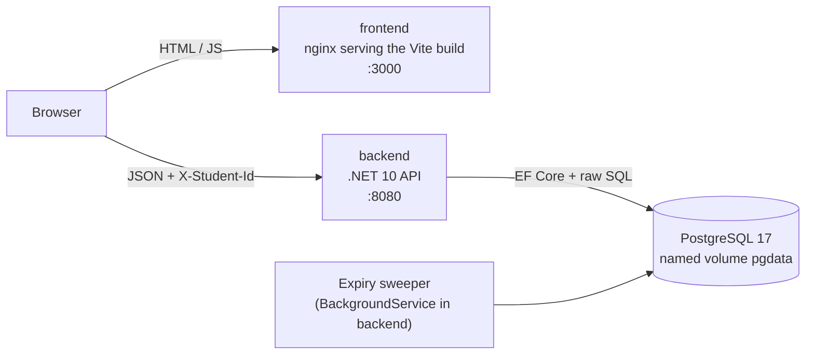
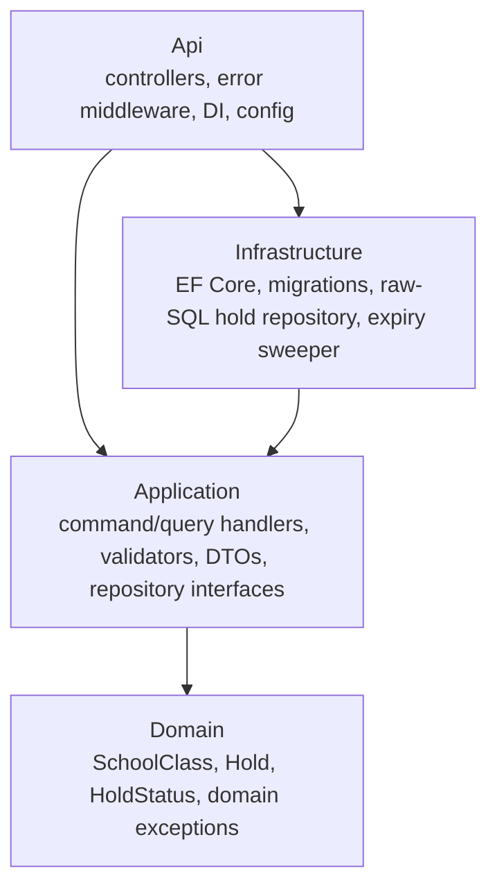
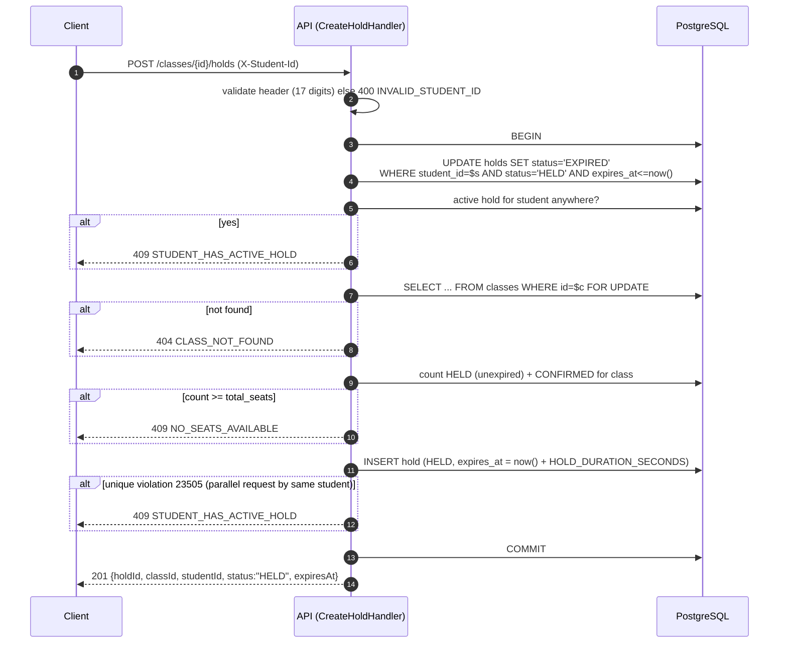
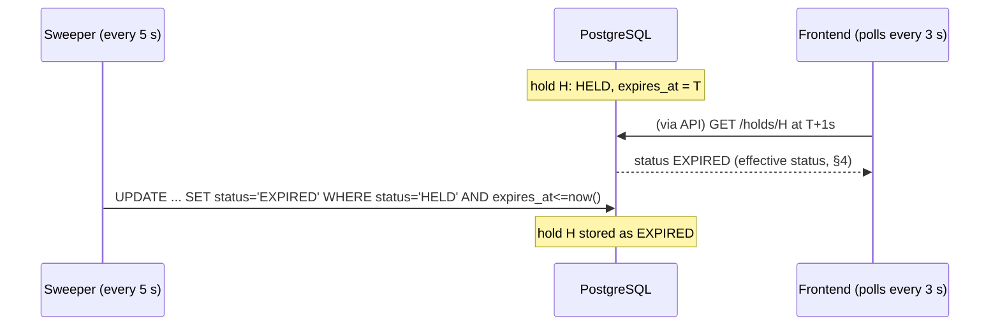

# Architecture

This document describes how the School Admission System works. Implementation tickets follow it; [STANDARDS.md](STANDARDS.md) has the coding rules. Key decisions are recorded as ADRs in [`docs/adr/`](adr/).

## 1. System overview



- The browser loads the static frontend from `:3000`, then calls the backend **directly** on `:8080`. The backend URL is baked in at build time ([ADR-0003](adr/0003-frontend-backend-url.md)), and the backend allows the frontend origin through CORS.
- **PostgreSQL is the only source of truth.** The backend keeps no in-memory state and uses no cache, so any number of backend instances can share one database ([§9](#9-multiple-backend-instances-bonus)).
- **Postgres `now()` is the only clock** used for expiry decisions, so app/DB clock skew cannot cause wrong results.

## 2. Backend layering

Clean Architecture with four projects and CQRS without a mediator (details in STANDARDS §1a).



| Endpoint | Controller → handler |
|---|---|
| `POST /classes` | `CreateClassHandler` (command) |
| `GET /classes` | `GetClassesHandler` (query) |
| `GET /classes/{classId}` | `GetClassByIdHandler` (query) |
| `POST /classes/{classId}/holds` | `CreateHoldHandler` (command, raw SQL) |
| `GET /holds/{holdId}` | `GetHoldByIdHandler` (query) |
| `POST /holds/{holdId}/confirm` | `ConfirmHoldHandler` (command, raw SQL) |
| `DELETE /holds/{holdId}` | `CancelHoldHandler` (command, raw SQL) |
| `GET /me/holds` | `GetMyHoldsHandler` (query) |

**Extra response fields** (allowed by the contract): `GET /holds/{holdId}` also returns `className` so the application page needs only one request, and object responses carry `serverTime` (§8.3).

Each handler runs its FluentValidation validator first. A failed validation throws, and the global error middleware turns it into `400 VALIDATION_FAILED`.

## 3. Data model

```sql
CREATE TABLE classes (
  id           uuid        PRIMARY KEY,
  name         text        NOT NULL,                       -- trimmed, non-empty, not unique
  total_seats  int         NOT NULL CHECK (total_seats > 0),
  created_at   timestamptz NOT NULL DEFAULT now()
);

CREATE TABLE holds (
  id           uuid        PRIMARY KEY,
  class_id     uuid        NOT NULL REFERENCES classes(id),
  student_id   varchar(17) NOT NULL CHECK (student_id ~ '^[0-9]{17}$'),
  status       text        NOT NULL CHECK (status IN ('HELD','CONFIRMED','EXPIRED','CANCELLED')),
  created_at   timestamptz NOT NULL DEFAULT now(),
  expires_at   timestamptz NOT NULL,
  confirmed_at timestamptz NULL,
  cancelled_at timestamptz NULL
);

-- One active hold or admission per student, across all classes (ADR-0001)
CREATE UNIQUE INDEX ux_holds_one_active_per_student
  ON holds (student_id) WHERE status IN ('HELD','CONFIRMED');

CREATE INDEX ix_holds_class_status     ON holds (class_id, status, expires_at); -- seat counts
CREATE INDEX ix_holds_student_created  ON holds (student_id, created_at DESC);  -- GET /me/holds
```

The schema is created by EF Core migrations, which the backend applies on startup.

**Class name ordering.** `classes.name` uses the ICU collation `numeric_ci` (`und-u-kn-ks-level2`, non-deterministic), created by the `AddClasses` migration. Digits compare by numeric value and case is ignored, so `GET /classes` (`ORDER BY name, created_at, id`, done in the database) lists `Class 6, Class 7, class 8, Class 10`. Names that differ only in case compare equal and come out oldest first.

### IDs
IDs are `uuid` in the database. The API shows them with a type prefix: `c_<32 hex>` for classes and `h_<32 hex>` for holds (e.g. `h_3f2a9c...`). The Api layer adds the prefix when serializing and strips it when parsing. **An ID that cannot be parsed returns 404**, the same as an ID that does not exist.

## 4. Seat counts and effective status

Every read computes the counts from the `holds` table, so they are correct even if the sweeper has not run yet:

| Field | Computation |
|---|---|
| `heldSeats` | count of holds with `status = 'HELD' AND expires_at > now()` |
| `confirmedSeats` | count of holds with `status = 'CONFIRMED'` |
| `availableSeats` | `totalSeats − heldSeats − confirmedSeats` |

**Effective status:** when a hold is read, a stored `HELD` whose `expires_at <= now()` is reported as `EXPIRED`. Clients never see a HELD hold that has run out of time.

## 5. Write flows

Every write runs in **one database transaction** (`READ COMMITTED`). The locks below make concurrent requests safe.

### 5.1 Create hold — `POST /classes/{classId}/holds`



- **Seat limit** ([ADR-0001](adr/0001-seat-concurrency.md)): the `FOR UPDATE` lock on the class row makes all hold creations for that class run one at a time, so count-then-insert cannot oversell.
- **One active hold per student:** the pre-check (step 4) exists only to give a clear error early. **The partial unique index is the real guarantee.** If two requests from the same student race, the second `INSERT` fails with `23505` and is mapped to 409.
- Step 3 frees the student's own stale holds first, so an expired hold that the sweeper has not processed yet does not block a new application.
- Lock order is always *own stale holds → class row → insert*, so two transactions cannot deadlock.

### 5.2 Confirm — `POST /holds/{holdId}/confirm`

```mermaid
sequenceDiagram
  autonumber
  participant C as Client
  participant A as API (ConfirmHoldHandler)
  participant D as PostgreSQL
  C->>A: POST /holds/{id}/confirm (X-Student-Id)
  A->>D: BEGIN; SELECT ... FROM holds WHERE id=$h FOR UPDATE
  alt not found
    A-->>C: 404 HOLD_NOT_FOUND
  else other student's hold
    A-->>C: 403 NOT_HOLD_OWNER
  else CONFIRMED
    A-->>C: 200 CONFIRMED (no change, idempotent)
  else CANCELLED
    A-->>C: 409 HOLD_CANCELLED
  else EXPIRED, or HELD with expires_at <= now()
    A->>D: UPDATE status='EXPIRED'; COMMIT
    A-->>C: 410 HOLD_EXPIRED
  else HELD and still valid
    A->>D: UPDATE status='CONFIRMED', confirmed_at=now(); COMMIT
    A-->>C: 200 {holdId, classId, status:"CONFIRMED", expiresAt, className, serverTime}
  end
```

HELD → CONFIRMED does not change *held + confirmed*, so the class row does not need to be locked. The lock on the hold row is enough to make a double confirm safe: the second request waits, then sees `CONFIRMED` and returns 200 without changing anything. `confirmedSeats` therefore goes up only once.

### 5.3 Cancel — `DELETE /holds/{holdId}`

```mermaid
sequenceDiagram
  autonumber
  participant C as Client
  participant A as API (CancelHoldHandler)
  participant D as PostgreSQL
  C->>A: DELETE /holds/{id} (X-Student-Id)
  A->>D: BEGIN; SELECT ... FROM holds WHERE id=$h FOR UPDATE
  alt not found
    A-->>C: 404 HOLD_NOT_FOUND
  else other student's hold
    A-->>C: 403 NOT_HOLD_OWNER
  else CONFIRMED
    A-->>C: 409 HOLD_ALREADY_CONFIRMED
  else CANCELLED or EXPIRED
    A-->>C: 204 (no change)
  else HELD with expires_at <= now()
    A->>D: UPDATE status='EXPIRED'; COMMIT
    A-->>C: 204
  else HELD and still valid
    A->>D: UPDATE status='CANCELLED', cancelled_at=now(); COMMIT
    A-->>C: 204
  end
```

## 6. Expiry

[ADR-0002](adr/0002-hold-expiry.md). There are two layers:

1. **Query time (source of truth).** Every read and write compares `expires_at` with `now()` (§4, §5). Correctness never depends on the sweeper.
2. **Sweeper (bookkeeping).** A `BackgroundService` in the backend runs every `EXPIRY_SWEEP_INTERVAL_SECONDS` (default **5**):
   ```sql
   UPDATE holds SET status = 'EXPIRED' WHERE status = 'HELD' AND expires_at <= now();
   ```
   The statement is idempotent, so several backend instances can run it at the same time.
   The first sweep runs one interval after startup. If a sweep hits a database error, it logs a warning and tries again on the next tick; the backend keeps running (query-time expiry stays correct meanwhile).



The frontend also counts down locally (corrected by the server time, §8.3). When the countdown reaches zero it shows EXPIRED and removes the Pay and Cancel buttons without waiting for the next poll or a page reload.

## 7. Errors

The error body shape is in STANDARDS §5. These are the codes (`userResponse.code`):

| Code | HTTP | When |
|---|---|---|
| `VALIDATION_FAILED` | 400 | Body fails validation; details in `errors[]` |
| `MALFORMED_REQUEST` | 400 | Body is not valid JSON or has the wrong types |
| `INVALID_STUDENT_ID` | 400 | `X-Student-Id` missing or not 17 digits |
| `NOT_HOLD_OWNER` | 403 | Confirm or cancel someone else's hold |
| `CLASS_NOT_FOUND` | 404 | Class ID unknown or unparseable |
| `HOLD_NOT_FOUND` | 404 | Hold ID unknown or unparseable |
| `NO_SEATS_AVAILABLE` | 409 | Class is full |
| `STUDENT_HAS_ACTIVE_HOLD` | 409 | Student already has a HELD or CONFIRMED hold in any class |
| `HOLD_ALREADY_CONFIRMED` | 409 | Cancel a confirmed hold |
| `HOLD_CANCELLED` | 409 | Confirm a cancelled hold |
| `HOLD_EXPIRED` | 410 | Confirm an expired hold |
| `ROUTE_NOT_FOUND` | 404 | No endpoint matches the URL |
| `METHOD_NOT_ALLOWED` | 405 | The URL exists but not for this HTTP method |
| `UNSUPPORTED_MEDIA_TYPE` | 415 | A body was sent with a Content-Type other than `application/json` (or none) |
| `INTERNAL_ERROR` | 500 | Unexpected fault (never caused by client input) |

Domain and application code throws typed exceptions (e.g. `NoSeatsAvailableException`). One middleware maps each exception type to its code and HTTP status. ASP.NET's default ProblemDetails responses are turned off, so model-binding errors use the same body, and a status-code fallback wraps every empty 4xx/5xx (unknown route, wrong method, wrong content type) in it too. The frontend shows text from its bn/en dictionary, looked up by `code`.

## 8. Frontend

### 8.1 Structure
Modular layout (STANDARDS §1b): `app/` (providers, router, error boundary), `modules/{classes,holds,student}`, `shared/{api,i18n,ui,lib}`. Screens, states, text and flows are specified in [UI_DESIGN.md](UI_DESIGN.md). Routes: `/` class list, `/admin` create class, `/holds/:holdId` application, `/me` my applications.

### 8.2 State and polling
- All server state goes through TanStack Query. Class lists, the current hold and "my applications" use `refetchInterval: 3000`.
- The student ID lives in `localStorage`, so holds are visible again after a refresh or a browser restart. The axios client adds it as `X-Student-Id`.
- The language choice (bn/en, default bn) is also kept in `localStorage`.

### 8.3 Server time
- Every response carries an **`X-Server-Time`** header (ISO-8601 UTC). **Object** responses also carry a `serverTime` field. Array responses (`GET /classes`, `GET /me/holds`) cannot get an extra top-level field without changing their shape, so they rely on the header.
- The axios client reads the header and keeps `offset = serverTime − Date.now()`. Countdowns use `expiresAt − (Date.now() + offset)`, so a wrong client clock does not matter.
- The backend exposes the header through CORS (`Access-Control-Expose-Headers: X-Server-Time`).

## 9. Multiple backend instances (bonus)

The seat rule holds with two or more backend processes on the same database because:
- the seat check and insert are serialized by a **database row lock** (`FOR UPDATE` on the class row), not by an in-process lock;
- the one-active-hold rule is a **database unique index**;
- expiry uses the **database clock**, and the sweeper's `UPDATE` is idempotent;
- the backend holds no state between requests.

How to try it is documented in ASSUMPTIONS.md (e.g. `docker compose up --scale backend=2` with a second port mapping, or running a second backend container against the same `db`).

## 10. Configuration

All configuration comes from environment variables, with `appsettings.json` defaults.

| Variable | Used by | Default |
|---|---|---|
| `ConnectionStrings__Default` | backend | `Host=db;Port=5432;Database=admission;Username=admission;Password=admission` |
| `HOLD_DURATION_SECONDS` | backend | `600` |
| `EXPIRY_SWEEP_INTERVAL_SECONDS` | backend | `5` |
| `CORS_ALLOWED_ORIGINS` | backend | `http://localhost:3000` (comma-separated list) |
| `VITE_API_BASE_URL` | frontend **build arg** | `http://localhost:8080` |
| `POSTGRES_USER` / `POSTGRES_PASSWORD` / `POSTGRES_DB` | `db` | `admission` / `admission` / `admission` (`ConnectionStrings__Default` must use the same user and password) |
| `TEST_DB_CONNECTION` | `backend-tests` | `Host=db;Port=5432;Database=admission_test;Username=admission;Password=admission` (built from `POSTGRES_*` in compose; the test fixture refuses any database other than `admission_test`) |

**Changing the backend URL** ([ADR-0003](adr/0003-frontend-backend-url.md)): Vite bakes `VITE_API_BASE_URL` into the JavaScript at build time. Compose passes it from an environment variable as a build arg, so after changing it you must run `docker compose up --build`. The README says this.

## 11. Docker Compose

| Service | Image | Port | Notes |
|---|---|---|---|
| `db` | `postgres:17-alpine` | not published | named volume `pgdata` (survives `down`/`up`), `pg_isready` healthcheck |
| `backend` | .NET 10 multi-stage (sdk → aspnet) | `8080:8080` | starts after `db` is healthy, **applies EF migrations on startup** (a hosted service, before the server listens; a failure logs the error and exits with code 1), `restart: on-failure` so compose retries, healthcheck `wget` on `/health` |
| `frontend` | node build → `nginx:alpine` | `3000:80` | build arg `VITE_API_BASE_URL`, SPA fallback to `index.html` |
| `backend-tests` | `mcr.microsoft.com/dotnet/sdk:10.0` | — | profile `test`; run with `docker compose run --rm backend-tests`. Bind-mounts `./backend` (always tests the current code), caches NuGet packages in a named volume, and keeps `bin/`/`obj/` in anonymous volumes. Uses a **separate database `admission_test`** on the same `db` server via `TEST_DB_CONNECTION`; a test fixture drops and recreates it once per run, so tests never touch real data |

`docker compose up` starts `db`, `backend` and `frontend`. Data persists across restarts and `docker compose down` / `up`. Only `docker compose down -v` deletes it.

## 12. Testing approach

- Integration tests call the real handlers or HTTP endpoints against the `admission_test` database (no mocks for business rules).
- **Concurrency test:** a class with N seats and many parallel hold requests from different students. Exactly N succeed, the rest get 409, and the counts in the DB match.
- **Expiry tests** set `HOLD_DURATION_SECONDS=2` and wait about 3 seconds instead of faking the clock, because expiry is decided by the database clock.
- Other tests cover idempotent confirm, the one-active-hold rule (including parallel requests from one student), 403/404/410 paths, and validation returning 400 rather than 500.

## 13. Spec rule → mechanism

| Rule | Enforced by |
|---|---|
| held + confirmed ≤ totalSeats under any concurrency | class row `FOR UPDATE` + count before insert (§5.1) |
| Holds expire automatically after `HOLD_DURATION_SECONDS` | query-time `expires_at > now()` + sweeper (§6) |
| One active hold or admission per student | partial unique index `ux_holds_one_active_per_student` (§3, §5.1) |
| Only the owner can confirm, and only a non-expired HELD hold | hold row `FOR UPDATE` + owner/status/expiry checks (§5.2) |
| Repeat confirm counts once | idempotent confirm under row lock (§5.2) |
| No data loss across restart / `down` + `up` | Postgres named volume `pgdata`; migrations are additive (§11) |
| Bad input → 4xx, never 500 | validators + typed exceptions + global middleware; unparseable IDs → 404 (§7) |
| Multiple backend instances | all coordination in the database (§9) |
| UI shows EXPIRED without reload | local countdown with server-time offset + 3 s polling (§6, §8) |
| Holds visible after refresh / browser restart | student ID in `localStorage` + `GET /me/holds` (§8.2) |
| Backend URL and DB connection configurable | `VITE_API_BASE_URL`, `ConnectionStrings__Default` (§10) |
