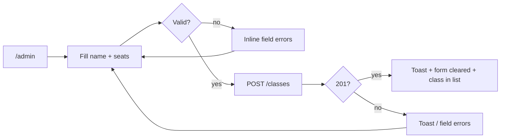
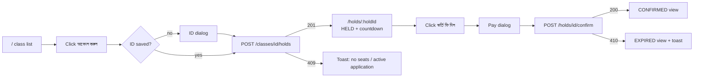
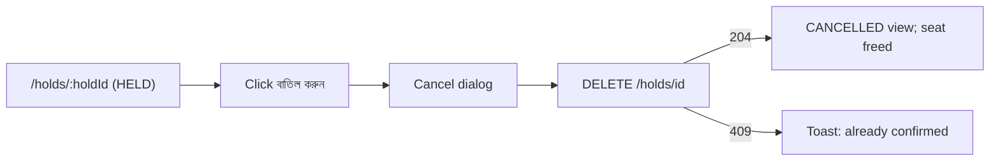
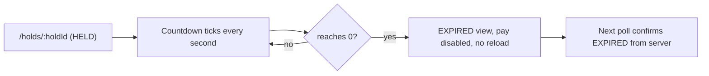

# UI Design

This is the blueprint for the React frontend. It covers every screen, every state, all user-facing text and the main flows. The UI is built with React, Tailwind and shadcn/ui (STANDARDS §1, §1b), using the clean shadcn default look: neutral grey and white, one accent colour, and a card per class.

## 1. General rules

- **Responsive.** The layout works from phone width (360 px) up to desktop. Cards stack in one column on narrow screens, and the nav folds into a ☰ menu.
- **Bilingual.** Every string comes from the `bn` / `en` dictionaries. Bangla is the default, and the choice is remembered in `localStorage`.
- **Bangla digits.** In `bn` mode, all numbers (seat counts, countdowns) are shown in Bangla digits (`০৯:৪২`). The student-ID input accepts both Bangla and English digits and converts them to English digits before sending.
- **Live data.** Class counts, the open application and "my applications" refresh every **3 s** (TanStack Query `refetchInterval: 3000`).
- **Countdowns** tick every second locally and are corrected by the server-time offset (ARCHITECTURE §8.3). Format: `mm:ss`. The countdown turns red when under 1 minute.
- **Never a blank page.** Every query has a loading state and an error state. An error boundary catches rendering crashes (§9).
- **Server unreachable.** A yellow banner appears under the header (§8, "Network down"). The last loaded data stays on screen, and polling keeps retrying.

## 2. Layout and navigation

```
┌──────────────────────────────────────────────────────────────────────┐
│ 🏫 ভর্তি    ক্লাসসমূহ | আমার আবেদন | ক্লাস তৈরি (অ্যাডমিন)     [বাংলা|EN] │
│                              শিক্ষার্থী: 20190123456789012 [পরিবর্তন] │
└──────────────────────────────────────────────────────────────────────┘
```
Phone:
```
┌──────────────────────────────┐
│ 🏫 ভর্তি            [বাংলা|EN] ☰ │
│ শিক্ষার্থী: 2019…9012 [পরিবর্তন] │
└──────────────────────────────┘
```

| Route | Screen |
|---|---|
| `/` | Class list (§4) |
| `/admin` | Create class (§5) |
| `/holds/:holdId` | Application (§6) |
| `/me` | My applications (§7) |
| anything else | "Page not found" with a link to `/` |

If no student ID is saved, the header shows the button **[শিক্ষার্থী আইডি দিন]** in place of the ID.

## 3. Student ID dialog

Opens when:
- the parent clicks Apply with no ID saved (after saving, the hold request is sent straight away);
- the parent clicks "পরিবর্তন" in the header;
- the parent opens `/me` with no ID saved.

```
┌ জন্ম নিবন্ধন নম্বর দিন ─────────────────┐
│ [ _________________ ]   ১৭ সংখ্যা         │
│ ⚠ ঠিক ১৭টি সংখ্যা দিন                     │
│               [বাতিল]   [সংরক্ষণ করুন]    │
└───────────────────────────────────────────┘
```
- The input is checked live. "সংরক্ষণ করুন" is enabled only for exactly 17 digits.
- The ID is saved in `localStorage` and sent as `X-Student-Id` on every request.

## 4. Class list `/`

```
┌ Class 1 – Morning ─────────────────────────┐
│ মোট ৪০ · অপেক্ষমাণ ৩ · নিশ্চিত ১০            │
│ খালি আসন: ২৭   ▓▓▓▓░░░░░░                  │
│                             [আবেদন করুন]   │
└────────────────────────────────────────────┘
```

| State | Display |
|---|---|
| Loading | Skeleton cards |
| Empty | "এখনো কোনো ক্লাস নেই।" with a link "ক্লাস তৈরি করুন" to `/admin` |
| Class full (`availableSeats = 0`) | Button disabled, label "আসন নেই" |
| Student has an active (HELD or CONFIRMED) application | All Apply buttons disabled; banner "আপনার একটি সক্রিয় আবেদন আছে।" with a link "দেখুন" to that application. Known from `GET /me/holds` |
| Applying | Clicked button shows a spinner; all Apply buttons disabled until the response |
| Success (201) | Navigate to `/holds/:holdId` |
| Error (409 etc.) | Toast with the error text (§8); counts refresh |
| Load error / server down | Banner (§1); last data kept |

## 5. Create class `/admin`

```
ক্লাস তৈরি করুন
ক্লাস/শিফটের নাম  [______________________]
মোট আসন          [______]
                  [তৈরি করুন]
───────────────────────────────
বিদ্যমান ক্লাস
Class 1 – Morning     মোট ৪০ · খালি ২৭
Class 2 – Day         মোট ৩০ · খালি ৩০
```
- **Inline validation:** a blank name shows "ক্লাসের নাম দিন।"; seats that aren't a whole number ≥ 1 show "আসন সংখ্যা ১ বা তার বেশি পূর্ণসংখ্যা হতে হবে।".
- **Server validation:** `errors[]` from a 400 response is shown under the matching field.
- **Submitting:** the button shows a spinner and is disabled.
- **Success (201):** toast "ক্লাস তৈরি হয়েছে।", the form is cleared, and the class appears in the list below.
- The class list on this page uses the same query as `/` (polled every 3 s), shown in compact form without Apply buttons. Empty state: "এখনো কোনো ক্লাস নেই।".

## 6. Application `/holds/:holdId`

```
┌ আবেদন — Class 1 – Morning ────────────────┐
│ অবস্থা:   [অপেক্ষমাণ]                       │
│ বাকি সময়:  ০৯:৪২                           │
│ [ভর্তি ফি দিন]            [বাতিল করুন]       │
└───────────────────────────────────────────┘
```
The class name comes from the extra `className` field on `GET /holds/{id}` (ARCHITECTURE §2).

| Status | Display |
|---|---|
| Loading | Skeleton card |
| HELD | Countdown; both buttons enabled |
| HELD, countdown reaches 0 | Switches **immediately** to the EXPIRED view, with no wait for the next poll |
| CONFIRMED | Green "✓ ভর্তি নিশ্চিত হয়েছে।"; no buttons |
| EXPIRED | Grey "সময় শেষ হয়ে গেছে।"; pay disabled; link "আবার আবেদন করুন" to `/` |
| CANCELLED | "আবেদন বাতিল করা হয়েছে।"; link "আবার আবেদন করুন" to `/` |
| 404 / unparseable ID | "আবেদনটি পাওয়া যায়নি।" with a link to `/` |
| Action error (403, 409, 410) | Toast with the error text (§8); the hold is refetched |

**Pay dialog**
```
┌ ভর্তি ফি পরিশোধ ─────────────────────────────┐
│ Class 1 – Morning-এর ভর্তি ফি পরিশোধ করবেন?      │
│ এটি আর বাতিল করা যাবে না।                       │
│                          [না]   [ফি দিন]       │
└──────────────────────────────────────────────┘
```
**Cancel dialog**
```
┌ আবেদন বাতিল ──────────────────────────────┐
│ আবেদন বাতিল করবেন? আসনটি ছেড়ে দেওয়া হবে।     │
│                       [না]   [বাতিল করুন]   │
└───────────────────────────────────────────┘
```
- While a request runs, the dialog button shows a spinner and both action buttons are disabled.
- If the hold expires while a dialog is open, the dialog closes and the EXPIRED view shows.
- Success: Pay shows toast "ভর্তি নিশ্চিত হয়েছে।"; Cancel shows toast "আবেদন বাতিল হয়েছে।". The page then shows the new status.

## 7. My applications `/me`

```
Class 1 – Morning   [অপেক্ষমাণ]   ০৮:১২   [দেখুন]
Class 2 – Day       [মেয়াদ শেষ]           [দেখুন]
Class 3 – Evening   [বাতিল]                [দেখুন]
```
- Newest first, as returned by `GET /me/holds`. HELD rows show a live countdown and switch to EXPIRED at 0.
- **Loading:** skeleton rows. **Empty:** "আপনার কোনো আবেদন নেই।" with a link "ক্লাস দেখুন" to `/`.
- **No ID saved:** the ID dialog opens. If the parent dismisses it, the page shows "আবেদন দেখতে শিক্ষার্থী আইডি দিন।" with a button that reopens the dialog.

## 8. Text

### Status badges and seat labels
| Key | বাংলা | English | Badge colour |
|---|---|---|---|
| HELD | অপেক্ষমাণ | Pending payment | amber |
| CONFIRMED | ভর্তি নিশ্চিত | Admitted | green |
| EXPIRED | মেয়াদ শেষ | Expired | grey |
| CANCELLED | বাতিল | Cancelled | grey |
| totalSeats | মোট | Total | — |
| heldSeats | অপেক্ষমাণ | Pending | — |
| confirmedSeats | নিশ্চিত | Confirmed | — |
| availableSeats | খালি আসন | Available | — |

### Error messages (looked up by `userResponse.code`)
| Code | বাংলা | English |
|---|---|---|
| `NO_SEATS_AVAILABLE` | দুঃখিত, এই ক্লাসে আর কোনো আসন খালি নেই। | Sorry, no seats are left in this class. |
| `STUDENT_HAS_ACTIVE_HOLD` | আপনার ইতিমধ্যে একটি সক্রিয় আবেদন আছে। | You already have an active application. |
| `HOLD_EXPIRED` | সময় শেষ হয়ে গেছে। আবার আবেদন করুন। | Time ran out. Please apply again. |
| `HOLD_CANCELLED` | এই আবেদনটি বাতিল করা হয়েছে। | This application was cancelled. |
| `HOLD_ALREADY_CONFIRMED` | ভর্তি নিশ্চিত হয়েছে, এখন আর বাতিল করা যাবে না। | Admission is confirmed and can no longer be cancelled. |
| `NOT_HOLD_OWNER` | এই আবেদনটি অন্য শিক্ষার্থীর। | This application belongs to another student. |
| `CLASS_NOT_FOUND` | ক্লাসটি পাওয়া যায়নি। | Class not found. |
| `HOLD_NOT_FOUND` | আবেদনটি পাওয়া যায়নি। | Application not found. |
| `INVALID_STUDENT_ID` | জন্ম নিবন্ধন নম্বর ঠিক ১৭ সংখ্যার হতে হবে। | Birth registration number must be exactly 17 digits. |
| `VALIDATION_FAILED` | ফর্মের তথ্য ঠিক করুন। | Please fix the form. |
| `MALFORMED_REQUEST` | অনুরোধটি সঠিক নয়। | The request was invalid. |
| `INTERNAL_ERROR` / unknown code | সার্ভারে সমস্যা হয়েছে। একটু পরে আবার চেষ্টা করুন। | Something went wrong on the server. Please try again. |
| Network down (no response) | সার্ভারের সাথে সংযোগ করা যাচ্ছে না। আবার চেষ্টা হচ্ছে… | Can't reach the server. Retrying… |

Codes the UI never triggers (`ROUTE_NOT_FOUND`, `METHOD_NOT_ALLOWED`, `UNSUPPORTED_MEDIA_TYPE`) use the `INTERNAL_ERROR` text.

### App shell
| Where | বাংলা | English |
|---|---|---|
| Brand | ভর্তি | Admission |
| Nav | ক্লাসসমূহ · আমার আবেদন · ক্লাস তৈরি (অ্যাডমিন) | Classes · My applications · Create class (admin) |
| Menu button (☰) | মেনু | Menu |
| Dialog ✕ (screen readers) | বন্ধ করুন | Close |
| Header, no ID | [শিক্ষার্থী আইডি দিন] | [Enter student ID] |
| Header, with ID | শিক্ষার্থী: … [পরিবর্তন] | Student: … [Change] |
| ID dialog | জন্ম নিবন্ধন নম্বর দিন · ১৭ সংখ্যা · ⚠ ঠিক ১৭টি সংখ্যা দিন · [বাতিল] [সংরক্ষণ করুন] | Enter birth registration number · 17 digits · ⚠ Enter exactly 17 digits · [Cancel] [Save] |
| Page not built yet | এই পাতাটি শীঘ্রই আসছে। | This page is coming soon. |
| 404 page | পাতাটি পাওয়া যায়নি। · ক্লাস তালিকায় ফিরে যান | Page not found. · Back to classes |

Field-level messages for `VALIDATION_FAILED` are shown under each field (texts in §5). The full UI dictionary lives in `shared/i18n/bn.ts` and `en.ts`; this document lists the user-facing strings that need agreement.

## 9. Crash screen

```
কিছু একটা ভুল হয়েছে।
[রিফ্রেশ করুন]
```
English: "Something went wrong." / "Refresh". The error boundary wraps the whole app; the button reloads the page.

## 10. Flows

### Admin creates a class


### Parent applies and pays


### Parent applies and cancels


### Hold expires

